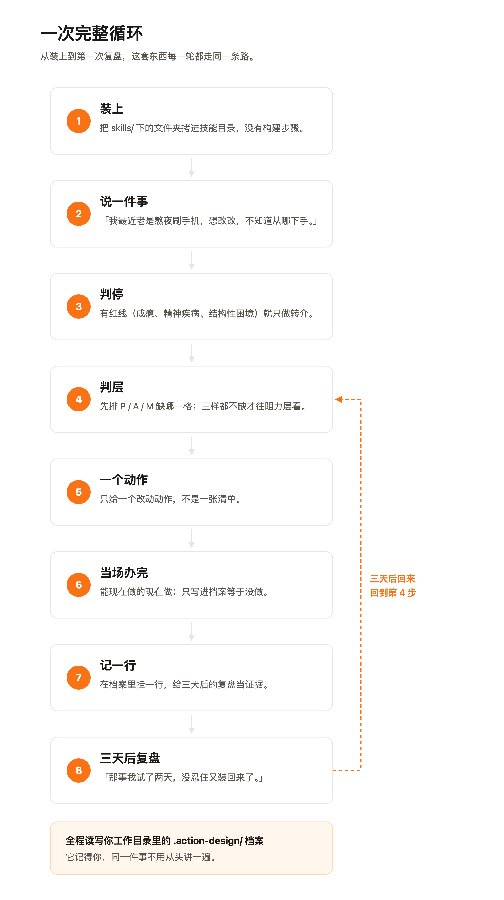
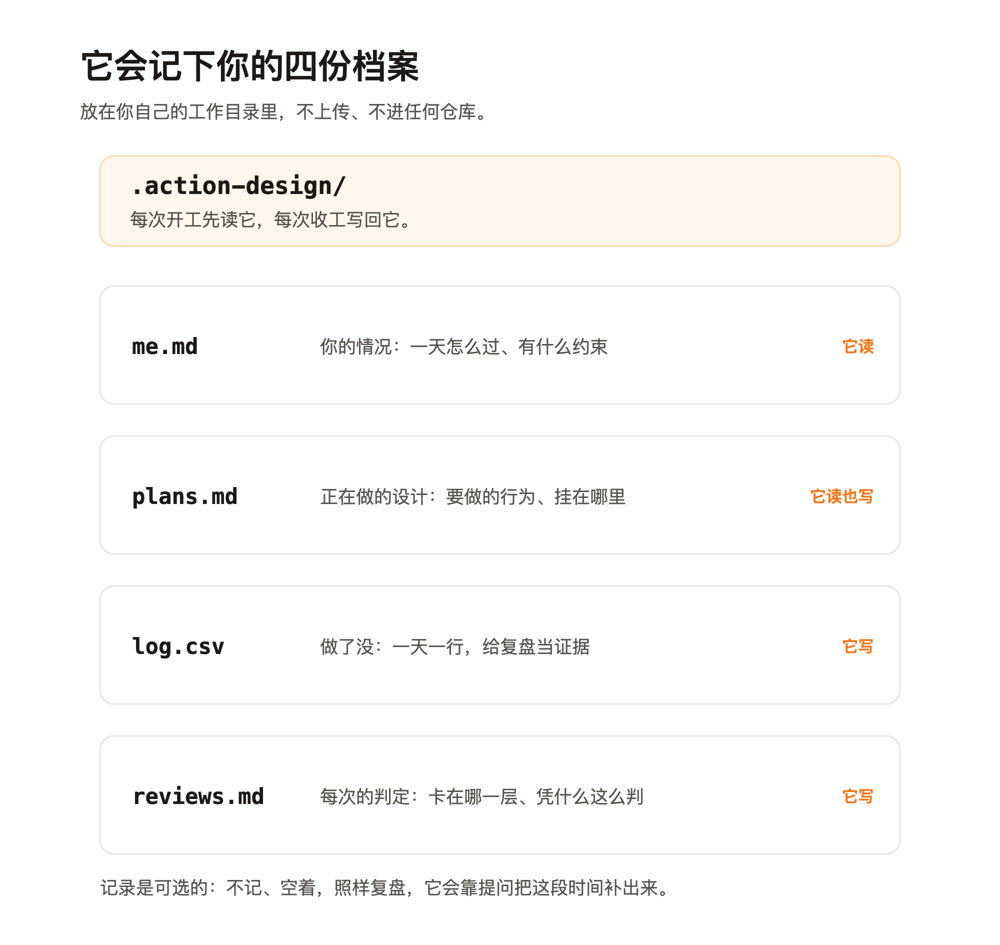
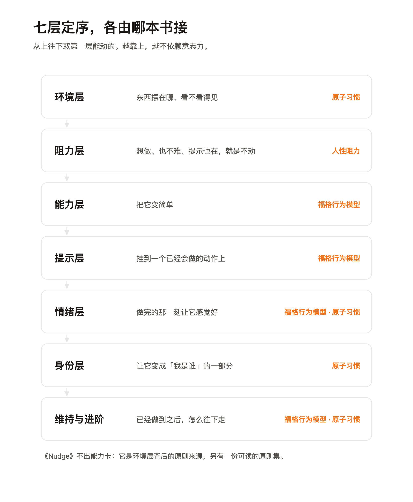
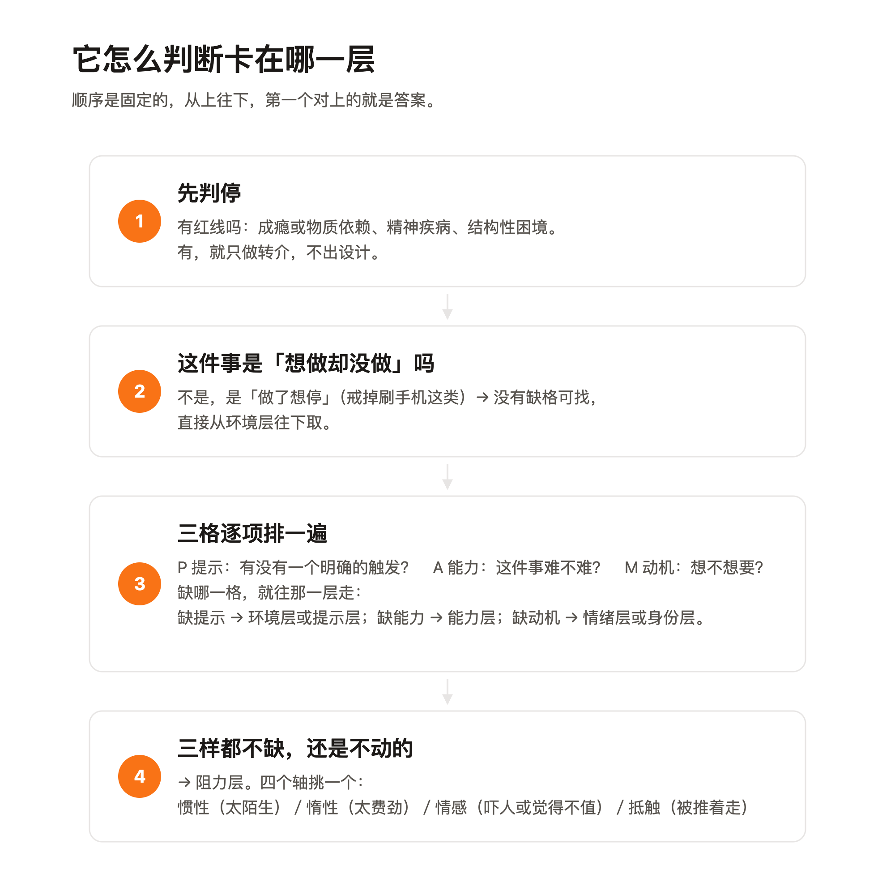

# 使用手册

这套东西叫「人类行动设计指南」。它把四本行为设计的经典著作拆成 Agent 能用的能力，再串成一条固定流程：**说一件事 → 它判断卡在哪 → 给一个动作 → 记下来 → 三天后回来复盘**。

这份手册是写给「想真的装上用一次」的人看的。全程不用写代码。



**你只需要三样**：

- 一个能从某个目录读 skill 的 Agent。比如 Cola、Claude Code、Codex，或者国内的腾讯 WorkBuddy、豆包工作、千问办公、Kimi Code CLI。这类都行，只要它支持 skill 目录。这是唯一的硬门槛。**而且它得是桌面端或命令行那种形态。** 它要能读你电脑上的文件夹，也要能在里面写文件：这套东西靠 `.action-design/` 那份档案接续，写不下去也读不回来，就没有「三天后回来」那一步了。纯网页版和手机版不算，它们看不到本机的文件夹。
- 它得能联网拉东西。最省事的装法是让 Agent 自己去仓库取，所以它得能用 `git` 或 `curl`。
- 你愿意把自己正在做的事说给它听。

不用会编程、不用敲命令、不用改任何配置、不用注册账号，装完之后也不用联网。

**用不上桌面端 Agent，也有一条路。** `guide/` 下三篇长文独立成篇，不用装任何东西，手机上也能读。读完能自己排查自己卡在哪、自己写出一条能落地的小动作。见文末「附四」。

## 一、装上

把这一句丢给你的 Agent：

> 帮我把这个装上：https://github.com/chitu-tang/action-design-guide ，照它仓库根目录的 INSTALL.md 做，装完告诉我装在哪。

再短一点也行，只要那个 Agent 读得到这个仓库：

> 装 skill：chitu-tang/action-design-guide

它会自己去取包、拷进 skill 目录、装完核一遍，然后告诉你装在哪。全程不用动手。

它照着读的那一份 [`INSTALL.md`](../INSTALL.md) 是写给 Agent 看的，里面把几条护栏写死了：不覆盖同名的已有 skill、不替用户建 `.action-design` 档案、不动任何已有配置。所以那句话就算发给了不太靠谱的 Agent，也不至于弄乱别的东西。

**想自己动手装，或者换电脑、换 Agent 要重装**：看文末「附一 · 装机」。

## 二、第一次：把一件事交给它

### 怎么开口

三种都行，把原话直接抄过去：

> 我想每天下班后读点书，就是坚持不下来。

> 我最近老是熬夜刷手机，想改改，但不知道从哪下手。

> 我三个月前想跑步，一直没开始，你帮我看看卡在哪。

关键是**带上自己的实际情况**。它要的不是「要一个方法」，是「正在发生什么」。只说「怎么让一个行为变简单」，它会转去那本书答，不走这条档案流程。

### 它会先问你几句

最多 10 问，只问会改变判断的那些。实际问到的大概是这些：

| 它问什么 | 为什么要问 |
|---|---|
| 一天大概怎么过：几点下班、到家到睡前在做什么 | 后面要挂的那个锚点，只能从你已经会做的动作里挑 |
| 以前试过什么、后来怎么停的 | 防止把一个试过没用的办法原样再给你一遍 |
| 最近有没有在看医生、吃药，或者被诊断过；有没有特别占人的硬约束 | 这条是硬停线，勾上就只做转介、不出设计 |
| 家里有谁、在家最常待在哪儿、那个地方手边一般有什么 | 环境这一层靠这个判断 |
| 每天大概能空出多少分钟、愿意额外费多少劲（低／中／高） | 决定给你的动作能有多大 |
| 想动的具体是哪一件事、有没有一本现在就想读的书 | 改造清单要指名道姓才有用 |

**答不全是常态。** 漏了它会回头再问一遍，不靠自己猜。答不上来的（「没算过」「不知道」）它会记成「未提供」，照常往下走，不会为了把表填满反复追问。你说一句「差不多就这样吧」，它就不问了。

### 一段完整的过程

> 下面是示例，按一次真实的冷启动测试改写，把两个测试人设合并成了同一个人。

**你**：我想每天下班后读点书，就是坚持不下来。

**它**：先问三句，问完停下等你答。
> ① 一般几点下班、几点到家？回到家到睡觉这段时间通常在做什么？
> ② 读书这件事以前是怎么试的？后来是怎么停下来的？
> ③ 最近有没有在看医生、吃药，或者被诊断过（情绪、睡眠、成瘾这类）？生活里有没有特别占人的硬约束？

**你**：六点半下班，七点多到家做饭吃饭，八点多就没事了，然后躺沙发上刷手机，反正困了才睡。别的没什么，都挺好的。

**它**：你只答了第一问，后两问我不能替你猜，原样再问一遍，顺带把背景补上。
> ① 读书以前具体是怎么试的？后来怎么停的？
> ② 最近有没有在看医生、吃药，或者被诊断过？有没有特别占人的硬约束？
> ③ 家里还有谁？在家最常待在哪儿，那个地方手边一般有什么？每天大概能空出多少分钟？愿意额外费多少劲，低、中还是高？

**你**：买过几本书，也下过电子书，翻两天就放下了，后来再没翻过。／没有，都挺好的。／就我一个住。晚上基本在沙发上，沙发上就是手机，电视也开着。书搁卧室桌子上了。多少分钟……没算过，也没数过。费劲的就别整了，别太累。

**它**：还差两个具体位置。
> ① 你坐沙发那段，手边够得着的地方有小茶几吗？手机是攥在手里，还是搁在旁边？
> ② 有没有一本你现在就想读的书？

**你**：手边有个小茶几，手机一般攥手里，有时候搁茶几上。／《人类简史》，买了一年多一直没翻。／差不多就这样吧，你先给我个说法。

**它**：好，按「可以收工了」理解，不再追问。这一轮的结果是这些。

**判定**：缺**提示**。想读的书在卧室、不在视线里，沙发上占场的是手机和电视。归**环境层 · 线索侧**。

**这次动这一件事**：

> ① 把《人类简史》从卧室桌上挪到沙发边的小茶几，摆在你坐下伸手够得着的正前方。
> ② 手机上沙发之前先移出视线，收进附近抽屉，或者留在卧室充电。电视不看就关掉。

**写进档案的**：工作目录下建了 `.action-design/`，四份文件（见「四、它会记下什么」）。

**下次三天后**，回来说一句「这几天做了什么、哪一次没做到」就行。

**它当场会请你做的那件事**：上面的 ①。这种动作没有提示、也没有锚点，不当场做基本不会发生，所以它会请你现在就把它做掉，做完再走。

### 为什么只给一个动作

**一次只动一个地方，是故意的。** 同时改三处，三天后你没法知道是哪一处起了作用，也就没法往下调。

所以它不会给你一张六条的建议清单，也不会六个层各给一条。它给你的是这一轮唯一该动的那一处。

## 三、三天后：回来复盘

### 怎么开口

一句话就够：

> 那事我试了两天，没忍住又装回来了。

> 这几天做了三次，有一次没做到，因为加班到十点。

不用整理，不用报告，说实况就行。

### 它会做什么

先读档案：`plans.md` 看当初设计的是什么，`log.csv` 看这几天到底做了几次。然后核对一件事：**这件事发生在哪段时间，那段时间是怎么过的**。档案里那一段没记，它会先问你一两句，不会凭空判。

### 三种结果，三个去向

| 你说的 | 它怎么读 | 往哪走 |
|---|---|---|
| 做了，但每次都得愣一下才想起来 | 提示还在，但不够牢 | 提示层：把动作挂到一个已经会做的动作后面 |
| 做了，但嫌麻烦，后面懒得做 | 动作本身太费劲 | 能力层：把它缩小，或者减几个步骤 |
| 压根没想起来 | 上一刀可能根本没落地，或者锚点没挂上 | 先确认那件事到底做没做，再往下判 |
| 做到了，一点用没有 | 这一层不是病根 | 回到定序往下判一层 |
| 说不清 | 说不清本身就是信号 | 它会追问是哪一种失败，不猜 |

**「已放弃」也是正常出口。** 它会在复盘时主动问要不要收掉，不拿它当失败，也不会露出「你该坚持」的意思。

### 一段完整的过程

**你**：书挪过去了，这两天晚上都翻了，就是每次都得愣一下才想起来。

**它**：先看了一下档案里那两天的记录。
> 两次都做到了，`weak` 一栏两次都填「提示」。说明线索这一刀是有效的，缺的是固定的触发点。

**判定**：上一刀把线索摆对了，书在眼前了；但「什么时候读」还没有触发点，每次都靠想起来。归**提示层**。

**这次动这一件事**：

> 在我把晚饭的碗收进水池之后，我会坐到沙发上翻开书。

**写回档案的**：`plans.md` 里那一行「提示」换成新锚点，`reviews.md` 加一条复盘。

**如果 `log.csv` 是空的**（你没记，或者刚建块还没开始记），它不会就此停下：先用一两句话问你「这几天做了几次、哪一次没做到、当时什么情况」，再照常往下走。空表不是失败的复盘。

## 四、它会记下什么

它会在你让 Agent 干活的**那个文件夹**里建一个 `.action-design/`，四份文件。

| 文件 | 管什么 | 要你管吗 |
|---|---|---|
| `me.md` | 你的情况：作息、常待的地方、手边有什么、以前试过什么 | 建档时说一次，之后它按补问添补 |
| `plans.md` | 正在做的设计：这一轮动哪一件事、下次什么时候复盘 | 不用 |
| `log.csv` | 做了没 | 想记就记，一天一行、睡前十秒 |
| `reviews.md` | 每次的判定，以及判的理由 | 不用 |

**记不记随你。** 空着 `log.csv` 照样复盘，它会靠提问把这段时间补出来。它不会追问「你记了吗」，也不会因为表是空的就跳过复盘。这是记录，不是成绩单：没有积分、没有连续天数、没有排行榜。

**但约定不是可选的。** 它不会自己找上门：你不开口它不动，你不回来，档案就停在那儿。「下次什么时候回来」这一件它一定会说清楚；说完了，日期得你自己在手机上设个提醒。它没有定时能力，也不会承诺「到点我提醒你」。

档案不上传、不进任何仓库、不发给任何人。要贴到公开场合时它会先问你。

> 想看四份文件具体长什么样：文末「附二 · 档案长什么样」。

## 五、常见卡住

**说了一句话，它没走这条路，直接讲起方法来了。**
判别线是**有没有执行事实**。「我试了一个月，一想到备料就算了」（试过但失败）和「我想了两个月，一次都没开始」（想做但没动）都算带着处境，都走这条路；「怎么让一个行为变简单」只有方法诉求，它会转去那本书答。把「我实际做了什么」说出来就行。

**它说我这件事不在它的范围内，让我找专业人士。**
那是硬停线，出现在这几种情况：成瘾或物质依赖、躯体戒断风险、自伤意念、进食障碍、精神疾病诊断、结构性困境（贫困、人身安全）。这时候它只做转介，不出设计，并把这一条记进 `me.md`。这不是漏答，是边界。

**它问的东西我答不上来，或者我不想写记录。**
答「没算过」「不知道」就行，它会记成「未提供」，照常往下走。记录本来就不用写，它不会追问。

**它给的动作我做不到，或者我上一刀压根没做。**
照实说。做不到本身就是信息，它会往下换一层，或者把动作缩得更小；没做的话它不扣分，会当场请你现在做掉，或者换成一个不用等条件的形式。

**我断了很久，还能接着用吗。想停掉一个计划呢。**
断多久都能接。档案还在，它先读档案，再问你这段时间的情况，断档这件事本身它也会看。要停就直接说「这个我不做了」，放弃是正常出口，和「已固化」是平权的。

**我装了四本书，想直接问某一本里的方法。**
直接说书名。「原子习惯里的两分钟法则怎么落地」，它走那本书的入口，不走档案这条路。入口走档案流程，是三本书之间那条融合的路。

## 六、它不做什么

- **不做医疗、心理或戒瘾建议。** 上面那六类情况一律转介。
- **不做打卡 App。** 无积分、无连续天数、无排行榜、无落后百分比。记录只服务诊断。
- **不替代原书。** 这是二手蒸馏，方法是我们的转述，原书原文不在仓库里。想深入，去买原书读。
- **不替书打包票。** 作者自己说是推测的地方，它逐条标了出来，没当成规律用。
- **不替你做决定。** 它给一个动作和理由，做不做在你。

---

**读到这里就可以用了。** 下面是补充，用不上可以直接跳过。

## 附一 · 装机（自己动手 / 重装）

换了一台电脑、换了一个 Agent，或者当时只装了其中一本现在想补齐，都从这里走。

1. 打开仓库页面，点绿色的 **Code** 按钮，选 **Download ZIP**。
2. 解压。里面有一个 `skills/` 文件夹。
3. 打开你的 Agent 的 skill 目录：

   | 宿主 | 常见位置 |
   |---|---|
   | Cola | `~/.cola/skills/` |
   | Claude Code | `~/.claude/skills/` |
   | 读 `~/.agents/skills` 的宿主（Codex 等） | `~/.agents/skills/` |

4. 把 `skills/` 里面的文件夹整个拷进去。

拷到哪儿都行，只要你的 Agent 从那个目录读 skill；上面三个只是常见宿主的约定位置。没有构建步骤，不用改配置，也不用重载什么。

**拷哪些**：

| 文件夹 | 是什么 | 要不要装 |
|---|---|---|
| `action-design-guide/` | 入口。负责读你的档案、判断卡在哪一层、路由到对应能力 | 想要「拿我的执行情况进去复盘」这种用法，必须装 |
| `atomic-habits/` | 《原子习惯》的能力包 | 建议装 |
| `fogg-behavior-model/` | 《福格行为模型》的能力包 | 建议装 |
| `human-element/` | 《人性阻力》的能力包 | 建议装 |

三本书的能力包可以单独装、单独用。只想问某一本书里的方法，装那一个就够；入口会按层去调它们，缺了哪个就会绕过去。

**两个提醒**：

- 装的就是「拷进去」这一个动作。没有安装程序，也没有卸载程序，要删就把那四个目录删掉。
- 目录里已经有同名的旧版本，先删掉再拷，别让新旧两份混在一个目录里。

### 国内常用的几个 Agent，装到哪

下面这几家都是按同一套约定读 `SKILL.md` 的，装法各有一点不同。

**共同的硬条件**：能跑的是**桌面端或命令行**那一种形态。纯网页版、手机 App、云电脑模式写的是沙箱或云盘，不是本机的工作目录，档案跨会话接不上。发东西给人试之前，先确认对方手上是哪种。

| Agent | 形态 | 装到哪 | 怎么装 |
|---|---|---|---|
| 腾讯 WorkBuddy | 桌面端 | `~/.workbuddy/skills/`，或者某个项目里的 `.workbuddy/skills/` | 技能市场里找；或者手工放进去、建个软链 |
| 豆包工作 | 桌面端（另有手机端和云电脑） | 手工上传一个技能文件夹 | 文件夹里要有 `skill.md`，开头两行写 `name` 和 `description`。没找到「给链接自动拉」的入口 |
| 千问办公 QwenWork | 桌面端（另有网页端和钉钉入口） | `~/.qwenworkcn/skills/` | 最省事：把仓库链接直接发给它，它自己去 clone |
| Kimi Code CLI | 命令行 | `~/.kimi-code/skills/` 或 `~/.agents/skills/` | `git clone` 到上面任一个目录 |

各家默认扫的目录不一样。`~/.agents/skills/` 是其中比较通用的一个位置，WorkBuddy、Trae、Qoder、Kimi Code CLI 都读它，放这儿最省事。

其实只要那个 Agent 按同一套约定读 `SKILL.md`，就都能用；上面四家是这一批里最常见的。

这张表是 2026 年 10 月核的。这类产品变得快，装法以各家官方文档为准。

**怎么知道装上了**：随便说一句「我想养成一个习惯，但就是坚持不下来」，看它会不会自己去翻那本书。或者直接点名：「用行动设计指南帮我看看」。

入口的触发词是这些，说中一个就会走档案这条路：行动设计、行动设计指南、我的行动档案、接着上次、继续之前那个计划、复盘我的执行、我这段时间做了什么、我实际做了什么、帮我记下来、卡在哪一层、不知道该用哪个方法。

## 附二 · 档案长什么样

下面是一份示例档案。`.action-design/` 建在让 Agent 干活的那个目录里。



**`me.md`**：你的情况。建档时写一次，之后按补问添补。

```markdown
# 关于我

## 一天的固定节点
| 时刻 | 我在做什么 | 可作锚点 |
|---|---|---|
| 18:30 | 下班 | ✓ |
| 约19:00 | 到家，做饭、吃饭 | ✓ |
| 约20:00 起 | 躺在沙发上，刷手机、电视开着 | |
| 起床到出门、中午 | 未提供 | |
| 入睡 | 未提供（困了才睡，没有固定点） | |

## 环境与约束
- 工作时间：18:30 下班（白天形状未提供）
- 家里有谁：一个人住
- 常待的地方：晚上基本在沙发上；沙发边有一个小茶几
- 手边常有的东西：手机（常攥在手里，有时搁在茶几上）、电视（开着）、小茶几；想读的《人类简史》原本放在卧室桌上

## 我能投入的
- 每天可支配：未提供（问过，答「没算过、没数过」）
- 愿意额外付出的精力：低

## 历史
| 试过什么 | 结果 | 我当时觉得卡在哪 |
|---|---|---|
| 买过几本纸质书、下过电子书 | 翻两天就放下，之后没再翻 | |

## 硬停线
- [ ] 成瘾史 / 精神疾病诊断 / 结构性困境（贫困、人身安全）
      勾上：只做转介，不出设计。
```

「可作锚点」那一列勾的是后面能用它挂新习惯的节点，要同时满足两条：本身是一件有始有终的具体动作（「到家」算，「躺在沙发上刷手机」这种时段不算），每天都会发生。

「留空」和「未提供」是两回事。这件事用不上这一格就留空；问过、当时答不上来的写「未提供」，那是个事实，下次还能再问。

**`plans.md`**：正在做的设计。一个计划一个块。

```markdown
## P001 · 晚上在沙发上读《人类简史》
- 设计于：2026-10-16
- 提示：坐进沙发（后面会换成更固定的锚点）
- 微行为：翻开书读一页
- 配方：在我坐进沙发之后，我会翻开书读一页
- 技巧：① 把《人类简史》从卧室桌上挪到沙发边的小茶几，摆在坐下伸手够得着的正前方；② 手机上沙发之前先移出视线，收进附近抽屉或留在卧室充电；电视不看就关掉
- 庆祝：读完之后心里说一句「成了」
- 加量 / 退回：状态差就读一页也行
- 判停条件：书在茶几上摆了一周仍没被翻开，说明问题不在线索，回来重判
- 状态：进行中
- 下次复盘：2026-10-19
- 改动史：
```

里面的「技巧」那一行装的是一次做完就算完的事（挪东西、布置、预备动作）。它只写「是什么」，不写「做了没」；做没做看 `log.csv` 里那一行。

**`log.csv`**：做了没。四列，就这四个。

```
date,plan_id,done,weak,note
2026-10-16,P001-env,yes,提示,书挪到茶几正前方，当场做完
2026-10-17,P001,yes,提示,翻了十页，得靠想起来
2026-10-18,P001,yes,,
2026-10-19,P001,no,提示,加班到十点，回家就躺下了
```

- `done`：`yes` / `no`
- `weak`：今天最弱的那一环，单选：动机／能力／提示／阻力／未知。**做没做到都能填**：没做到时它就是原因；做到了但某一步是勉强的，那一环也写在这儿；没有明显弱环就留空。
- `note`：一句话，可以空。

带 `-env` 后缀的那一行，是那种「说定了、但还没做」的一次性动作。它挂到做完为止，做完把那一行改成 `yes`。上面那行当场就做完了，所以直接是 `yes`。

**`reviews.md`**：每次的判定。每次复盘加一条，四项。

```markdown
## 2026-10-16 · 诊断（晚上读书这件事）
- 判定：缺**提示**。想读的书在卧室、不在视线内，沙发上是手机与电视这些坏线索占场。归**环境层 · 线索侧**。
- 依据：先用 B=MAP 的 P／A／M 排查，缺的是 P；再按定序取最靠前的可动层，落在环境层；环境层内按「看得到什么」判为线索侧。
- 改动：落线索侧的两条布置（书挪到茶几、手机移出沙发视线）。
- 下一步看什么：三天后书有没有被翻开。翻开了说明线索对了；还是没翻，说明卡点不在线索，回来重判。
```

## 附三 · 它是怎么想的

### 定序：从改环境到改自己



七层，从上往下取第一层能动的。越靠上越不依赖意志力，所以先动那一头。最下面一层不是「继续努力」，它管的是「已经成了之后，接下来怎么办」。

### 判层：从上往下，第一个对上的就是答案



先判停，再判层。三格逐项排一遍，缺哪一格就往那一层走；三样都不缺、却还是不动，才看阻力层。

### 为什么两本书打架时不摆给你选

同一个问题，两本书可能给不同答案。它不会把两种说法并排摆出来让你自己挑，而是按固定的三条规则判一个出来，并把判的理由写进档案的「依据」一行。

下次复盘时你翻档案，能看到上次为什么这么选。这一条比给对答案更重要：**理由记下来了，错的时候才改得动。**

### 加载卡的规则

判层之后，它会去读对应那本书自己的路由表，按层挑**一张**卡。

「一张卡」是「一次只动一个地方」，不是「不许换卡」。诊断类的卡不产出动作，它们只给分类和去向，去向那张卡接着加载。

## 附四 · 再往下看

### 四本书各管什么

| 书 | 在这套东西里管什么 | 产物 |
|---|---|---|
| 《福格行为模型》BJ Fogg, *Tiny Habits* | 能力层、提示层、情绪层，以及维持与进阶的一半 | 19 张能力卡 |
| 《原子习惯》James Clear, *Atomic Habits* | 身份层，兼环境线索侧、追踪复盘、承诺问责 | 20 张能力卡 |
| 《人性阻力》Nordgren & Schonthal, *The Human Element* | 阻力层：想做、做了也不难、提示也在，就是不肯动 | 15 张能力卡 |
| *Nudge: The Final Edition* Thaler & Sunstein | 不出能力卡。它是环境层背后的原则来源 | 一份原则集 ＋ 一份术语表 |

三本共 54 张能力卡，每张写死六件事：出处、这套方法在讲什么、一个真实应用、什么情况下会用到它（含**不该触发它的情形**）、执行步骤与输入输出契约、边界与反例。

要看清每张卡具体怎么用，读那本书自己的 `skills/<书名>/SKILL.md`，里面的「能力路由」表逐条写着每张卡的准入意图和不适用去向。仓库根目录的 [README](../README.md) 有每本书的详细清单。

### 没有 Agent 怎么用

`guide/` 下三篇长文独立成篇，不用装任何东西：

- [`guide/foggs-behavior-model.md`](../guide/foggs-behavior-model.md)
- [`guide/atomic-habits.md`](../guide/atomic-habits.md)
- [`guide/human-element.md`](../guide/human-element.md)

读完能自己用 B=MAP 排查卡点、自己写出微习惯配方，也能自己用四步模型定位习惯卡在哪一环。

[`principles/`](../principles/) 下是 Nudge 那一本的原则集与术语表，是一份可查的清单：想弄清「默认值为什么黏人」「淤泥指什么」，直接翻那里。

### 每条结论是从哪来的

[`sources/`](../sources/) 是完整账本：每本书的结论逐条列明出自哪一章、哪一节。能力卡正文里那些 `f01`、`p15`、`c72` 之类的编号，在这里都能查到。

每一条结论都先定位到原书的具体章节，再经过独立核验，最后才决定是变成一张能力卡，还是只作为背景保留。

---

写得不对的地方，欢迎开 issue。
